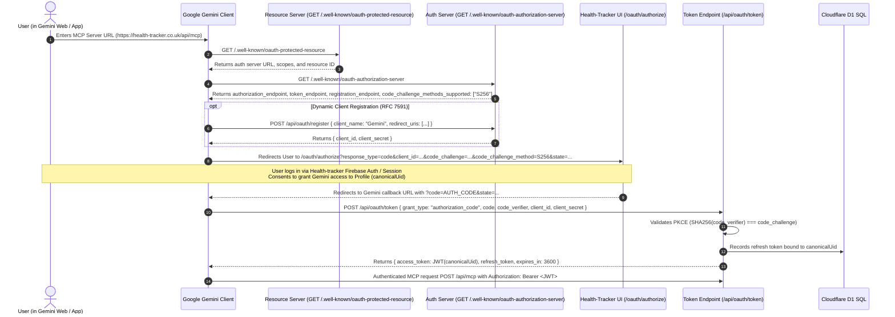
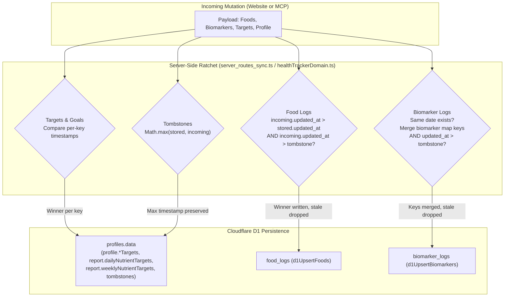

# Gemini Custom Connected App (MCP) Integration Plan — Revised Architecture

## 1. Executive Summary & Design Principles

This plan establishes a **complementary, 100% swappable bi-directional architecture** between the **Health-tracker Website** and **Gemini Custom Connected Apps (MCP)** on a **per-profile basis**.

### Core Architecture Laws
1. **Single Account, Single Pipeline:** Reads search `possibleUids`; writes go to `canonicalUid`. All food calculations have one writer (`finalizeDishLedger`). No second pipeline is created (AGENTS.md L5, L9, L12).
2. **True OAuth 2.1 Handshake:** Replaces the invalid client-credentials assumption. Gemini connects via standard MCP OAuth 2.1 (Protected-Resource Metadata, Authorization-Server Metadata, Authorization Code + PKCE S256, and interactive login/authorization). The user profile is bound by whoever authenticates during authorization.
3. **Server-Side Sync Ratchet:** Per-key timestamps for targets (including `report.dailyNutrientTargets`), conditional D1 upserts (`updated_at > stored.updated_at` and `updated_at > tombstone`), and client-side focus/visibility pulls.
4. **Tool Consolidation (5 Domain Tools):** Replaces 30 flat tools with 5 single-tool domain interfaces using an `action` argument. Tools accept `idempotency_key`, respect `profile.timezone`, and return absolute photo URLs (`https://health-tracker.co.uk/photos/...`).
5. **Strict Scope & Data Isolation:** Global catalog writes (`quarantineAtwaterFailures`, `upsertFoodAlias`) remain restricted to admin routes. Profile debug tools are read-only (debug tree, meal math dry-run, own-profile biomarker audit, and capped bug ticket filing).

---

## 2. Authentication: The Gemini MCP OAuth 2.1 Chain

Gemini Custom Connected Apps (`gemini.google.com`) and Gemini Enterprise execute the standardized MCP OAuth 2.1 authorization chain.



### 2.1 The Two Client Registration Surfaces
1. **Gemini Consumer Web / Mobile Apps (`gemini.google.com`):**
   - Implements RFC 7591 Dynamic Client Registration (DCR) via `POST /api/oauth/register`.
   - If DCR is skipped by the client, Gemini prompts the user under "Show more" for static `client_id` and `client_secret` generated on the Health-tracker Settings page.
2. **Gemini Enterprise (Google Cloud Console / Vertex AI):**
   - Admin registers an OAuth Web Client in Health-tracker with authorized redirect: `https://vertexaisearch.cloud.google.com/oauth-redirect`.
   - Admin enters the static `client_id` and `client_secret` in the Enterprise data store configuration.
   - Crucial Multi-Tenant Rule: The client ID identifies the **Gemini Application**, NOT the end user. When an employee triggers the flow, they authenticate via `/oauth/authorize`, and their issued token binds strictly to their own `canonicalUid`.

### 2.2 Unauthenticated Challenge
When Gemini connects to `POST /api/mcp` without credentials, the server responds with:
```http
HTTP/1.1 401 Unauthorized
WWW-Authenticate: Bearer realm="health-tracker",
  authorization_uri="https://health-tracker.co.uk/oauth/authorize",
  resource_metadata="https://health-tracker.co.uk/.well-known/oauth-protected-resource"
```

---

## 3. Server-Side Sync Ratchet & Parity Rules

To guarantee that an open website tab never overwrites a newer MCP edit and an MCP write never corrupts the website state, both surfaces adhere to the following server-side synchronization invariants:



### 3.1 Per-Key Timestamp Resolution for Targets
* **The Problem:** The website reads `report.dailyNutrientTargets` (and `weeklyNutrientTargets`) on the Homepage (`src/components/HomeTab.tsx`). Target maps merged via `{ ...cloud, ...incoming }` let a stale browser tab overwrite newer MCP target edits.
* **The Fix:**
  1. The server maintains a per-target timestamp map: `targetTimestamps: { [nutrientKey]: epochMs }` in `profiles.data`.
  2. When writing targets (from either Website `/api/sync/supabase-push` or MCP `manage_home`), the server compares timestamps **per nutrient key**. The later timestamp wins for that specific nutrient.
  3. The server synchronously updates **both** `profile.targets` / `profile.generalNutrientTargets` **and** `report.dailyNutrientTargets` / `report.weeklyNutrientTargets`.
  4. Bumps `report.timestamp = new Date().toISOString()` and `profile.lastUpdatedAt = Date.now()`.

### 3.2 Conditional Upsert for Foods & Biomarkers
* Update `d1UpsertFoods` and `d1UpsertBiomarkers` in `server_db_d1.ts`:
  - An upsert executes only if `excluded.updated_at > food_logs.updated_at` AND `excluded.updated_at > coalesce(tombstone_timestamp, 0)`.
  - If a stale client re-uploads a previously deleted food or an older revision, D1 ignores the write.

### 3.3 Same-Date Biomarker Merging
* Biomarker logs in Health-tracker are date-keyed (`YYYY-MM-DD`).
* When MCP or the Website logs a biomarker for a given date, the server loads any existing row for `(canonicalUid, date)`. It merges the new reading into the existing `biomarkers` JSON map (`Object.assign(existing.biomarkers, incoming)`), preserving all other tests from that panel.

### 3.4 Client-Side Focus & Visibility Pull
* In `src/hooks/useAppSync.ts`:
  - Attach listeners for `visibilitychange` (`document.visibilityState === 'visible'`) and `window.focus`.
  - Debounced at 5 seconds, calls `checkForDbChanges(undefined, false)` using the existing incremental `lastSyncTime` path.
  - When returning to the website from Gemini, the website automatically pulls the latest MCP changes without needing a manual refresh.
* In `src/utils/syncUtils.ts`:
  - `mergeProfiles(cloud, local)`: Compares `lastUpdatedAt`. The newer profile wins top-level fields, while tombstone maps are unioned via `mergeDeleteMaps(cloud.deleted..., local.deleted...)`.
  - `foodUnionMap`: Compares `(serverItem.updated_at || 0)` vs `(existingLocal.updated_at || 0)`. The newer record wins on content, while `imageUrls` are preserved via `uniqueMealImageUrls`.

---

## 4. Consolidated Tool Architecture (5 Domain Tools)

Instead of 30 flat tools that cause model selection errors, tools are organized into **5 domain interfaces** with an `action` argument.

### General Tool Constraints
* **Idempotency Key:** Mutating actions require an `idempotency_key` (UUID or string) to prevent duplicate inserts on Gemini retries.
* **Timezone Awareness:** "Today" is computed using `profile.timezone` via `getCurrentDateInTimezone`.
* **No Inline Base64 Images:** Tool responses return public absolute URLs (`https://health-tracker.co.uk/photos/...`).
* **Asynchronous Jobs:** Long-running meal analysis (~30–180s) returns `{ jobId, status: "processing" }` immediately; Gemini polls via `manage_jobs`.

---

### Tool 1: `manage_home`
Manages Homepage dashboard, daily/weekly targets, health actions, daily habits, and profile metadata.

* **Actions:**
  * `get_dashboard`: Returns today's consumed vs. target for the 31 nutrients in `defaultNutrientTargets`, weekly rollups (`weeklyTargetFromDaily`), active calorie/weight goals, `report.healthBaselineCategories`, active `actions`, `dailyBenefits`, and in-flight jobs.
  * `set_targets`: Updates one or more daily or weekly nutrient/macro/step targets. Updates `profile.targets` and `report.dailyNutrientTargets` with per-key timestamps.
  * `manage_actions`: Add, update, toggle complete, or delete items in `actions: HealthAction[]`.
  * `manage_habits`: Add, toggle complete, or delete items in `dailyBenefits: DailyBenefit[]`.
  * `get_profile`: Returns user profile demographics, preferences, and dietary restrictions.
  * `update_profile`: Updates nickname, language (`en`, `id`, `fr`, `zh`), timezone, or dietary restrictions. Runs `maybeRecalibrateDemographicOverlays`.

---

### Tool 2: `manage_meals`
Manages meal browsing, AI vision/text analysis, structured entry, and editing.

* **Actions:**
  * `list`: Browse meals with filters (`date_from`, `date_to`, `search_query`, `min_calories`, `max_sodium`, `verdict`, `limit`, `offset`). Tombstones are pre-filtered.
  * `get_detail`: Fetches full meal record by `mealId`, returning all 29 nutrients, ingredient breakdown (`itemsBreakdown`), Scout vision items, absolute photo URLs (`https://health-tracker.co.uk/photos/...`), chat transcript, and verdict.
  * `analyze_and_log`: Initiates meal analysis from text, photo URL, or previous meal reference (`sourceMealId`). Runs the server pipeline (`server_food_analyze_run.ts` / `serverJobs.ts`). Returns `{ jobId, status }` for asynchronous processing or completed meal if synchronous.
  * `log_structured`: Directly logs a meal with known items/weights. Runs `finalizeDishLedger` + `reapplyDerivedNutrients` + `resolveMealVerdict` so calorie math (`4*P + 4*C + 9*F`) is preserved.
  * `edit`: Edits an existing meal using natural language or structured patches (`change_weight`, `replace_item`, `add_item`, `remove_item`). Executes via `server_meal_edit.ts`.
  * `delete`: Deletes a meal from D1 and writes `deletedFoodLogIds[mealId] = Date.now()` to prevent client resurrection.

---

### Tool 3: `manage_biomarkers`
Manages biomarker history, trends, lab report parsing, and dictionary definitions.

* **Actions:**
  * `list`: Retrieves consolidated history by date range or marker keys (`ldl_cholesterol`, `hba1c`, `fasting_glucose`, etc.) with canonical names, reference ranges, and severity scores.
  * `get_trends`: Longitudinal trend analysis (min, max, delta %, rate of change, status shifts).
  * `log_entries`: Logs readings for one or more dates. Normalizes dates, standardizes units, checks `isBiomarkerValueImprobable`, and merges into existing date rows without overwriting other markers.
  * `ingest_lab_text`: Parses raw OCR lab report text using `lexTable` + `buildIngestBatch`.
  * `edit_values`: Edits specific `(date, key, value)` readings or moves a reading to a `newDate`.
  * `delete_values`: Deletes either a single biomarker key from a date log (preserving other tests) OR deletes an entire date log with `deletedBiomarkerLogIds` tombstone.
  * `manage_dictionary`: Add/edit custom biomarker definitions (`profile.customBiomarkers`), hide/unhide unused markers (`notUsedBiomarkers`), or manage groupings.

---

### Tool 4: `manage_jobs`
Manages in-flight asynchronous analysis jobs.

* **Actions:**
  * `list`: Lists active, queued, or stuck jobs from `agent_jobs` for the authenticated profile.
  * `get_status`: Returns current status (`queued`, `processing`, `completed`, `failed`), progress percentage, status message, intermediate scout items, and final `mealId`.
  * `update_instructions`: Injects guidance into an in-flight job (e.g. correcting a misrecognized food or clarifying portions). **Acquires the job-session turn lock** before writing to prevent `STALE_TURN`.
  * `cancel`: Aborts an in-flight job and clears its placeholder card.

---

### Tool 5: `diagnose_health_data`
Diagnostic and self-healing tools strictly scoped to the user's own data.

* **Actions:**
  * `get_meal_debug_tree`: Fetches the R2 debug payload for a meal or job, running `src/utils/debugRunTree.ts` and `src/utils/dumpContract.ts` to classify oracle failures (`FALSE_FRIEND`, `DISH_DROP`, `STALE_TURN`, Atwater mismatch).
  * `simulate_calculation`: Dry-run sandbox to test how ingredient/weight changes affect derived calories and nutrients without writing to D1.
  * `audit_biomarkers`: Runs `src/utils/biomarkerAuditEngine.ts` to detect duplicate alias groups, unit conversion mismatches (10x/100x errors), and same-date duplicate rows for this profile. Dry-run by default; live deduplication only when explicitly flagged.
  * `diagnose_sync`: Scans the profile's D1 records across `possibleUids` for orphan photo references (`ref:<id>`) or stuck jobs.
  * `file_bug_ticket`: Files a structured defect ticket into Health-tracker's queue (`serverBugAutoFile.ts`). **Strictly capped at 1 open ticket per meal and oracle code.**
* **Security Guard:** Global catalog mutations (`quarantineAtwaterFailures`, `upsertFoodAlias`, `mergeFoodCatalogItems`) are strictly excluded from MCP profile tokens and remain on admin-only routes.

---

## 5. Dynamic Schema Resource (`resources/read`)

To remain future-proof as new nutrients or biomarkers are added to the codebase, the server exposes the MCP resource:
* **URI:** `schema://health-tracker/catalog`
* **Content:** Dynamically serialized JSON containing:
  1. All 31 active nutrient keys from `defaultNutrientTargets` in `HomeTab.tsx` with their units and display labels.
  2. All standard biomarker definitions from `biomarkerDefinitions` plus the user's `customBiomarkers`.
  3. Valid action names and parameters for the 5 domain tools.
Gemini queries this resource at connection time, eliminating hardcoded schema assumptions.

---

## 6. Native Prompts Library (`prompts/list`)

1. `audit_meal_accuracy` (`meal_id` optional): Forensic review comparing the R2 photo against the breakdown and debug tree, offering corrective edits via `manage_meals(action: 'edit')`.
2. `daily_nutrition_debrief` (`date` optional): End-of-day assessment evaluating intake against targets and recommending concrete evening adjustments.
3. `biomarker_diet_correlation` (`biomarker_key` optional): Cross-correlates out-of-range lab results with rolling nutrient trends over 30–90 days.
4. `triage_and_fix_latest_issue`: Inspects the latest meal/job debug tree, runs biomarker/sync audits, and applies own-data repairs or files a capped bug ticket.

---

## 7. Phased Implementation Roadmap

```text
Phase 1: Handshake Spike (Metadata, Registration, OAuth 2.1 Auth Code + PKCE, login, manage_home:get_profile)
Phase 2: Server-Side Sync Ratchet & Client Parity (per-key targets, conditional D1 upsert, focus pull)
Phase 3: Shared Domain Service (src/server/domain/healthTrackerDomain.ts - one writer for web & MCP)
Phase 4: Tool Implementation (manage_home, manage_meals, manage_biomarkers, manage_jobs)
Phase 5: Dynamic Schema Resource & Prompt Templates (schema://health-tracker/catalog, prompts/list)
Phase 6: Diagnostic & Capped Bug Filing Tools (diagnose_health_data)
Phase 7: Settings UI ("Connect to Gemini MCP") with 1-click credential setup and i18n
```

### Phase 1: Handshake Spike
- Endpoints: `/.well-known/oauth-protected-resource`, `/.well-known/oauth-authorization-server`, `/oauth/authorize`, `/api/oauth/token`, `/api/oauth/register`.
- Implement `manage_home(action: 'get_profile')`.
- Gate: Verify end-to-end OAuth connection and profile retrieval from `gemini.google.com`.

### Phase 2: Server-Side Sync Ratchet & Client Parity
- Implement per-key timestamps for targets in `profiles.data` and update both `profile.*Targets` and `report.dailyNutrientTargets`.
- Update `d1UpsertFoods` and `d1UpsertBiomarkers` to enforce `updated_at > stored.updated_at` and tombstone checks.
- Add `visibilitychange` / `window.focus` pull listener in `useAppSync.ts`.
- Gate: `npx vitest run src/utils/syncUtils.regression.test.ts` + round-trip test.

### Phase 3: Shared Domain Service Layer
- Create `src/server/domain/healthTrackerDomain.ts`. Move meal, biomarker, target, and job operations into this shared module.
- Refactor existing Express routes (`server_routes_sync.ts`, `server_routes_food.ts`, `server_routes_jobs.ts`) to call this shared service.

### Phase 4: Core Domain Tools
- Wire `manage_home`, `manage_meals`, `manage_biomarkers`, and `manage_jobs` to the shared domain service.
- Enforce idempotency keys, timezone derivation, same-day biomarker merging, and job-session turn locks.

### Phase 5: Dynamic Schema Resource & Prompts
- Expose `schema://health-tracker/catalog`.
- Register the 4 native clinical prompts.

### Phase 6: Diagnostic & Self-Healing Suite
- Implement `diagnose_health_data` (debug tree, meal calculation simulation, biomarker audit, sync diagnostics, capped bug filing).
- Verify global catalog mutations are inaccessible via MCP.

### Phase 7: Settings UI & i18n
- Add "Connect to Gemini MCP" card in `ProfileModal.tsx`.
- Provide 1-click copy for MCP URL, Client ID, Client Secret, and revocation controls with translations (`en`, `id`, `fr`, `zh`).

---

## 8. Definition of Done & Bi-Directional Acceptance Criteria

- [ ] **Handshake Green:** OAuth 2.1 code + PKCE flow completes cleanly at `gemini.google.com`.
- [ ] **Add Parity:** Meals, biomarkers, and targets added via MCP appear on the Website; items added via Website appear in MCP.
- [ ] **Edit Parity:** Editing a meal or target via MCP is not overwritten when an open Website tab syncs.
- [ ] **Delete Parity:** Deleting a meal or biomarker via MCP persists across Website reloads (tombstone respected).
- [ ] **Same-Day Biomarker Integrity:** Adding a marker on MCP for an existing date merges into that date's row without dropping existing panel tests.
- [ ] **Live Focus Sync:** An open Website tab updates automatically within 5 seconds of focusing when an MCP edit occurs.
- [ ] **Single Pipeline Invariant:** Calories match `finalizeDishLedger`; no second food calculation path exists.
- [ ] **Bug & Scope Safety:** `diagnose_health_data` files at most 1 ticket per meal/oracle failure and cannot mutate the global catalog.
